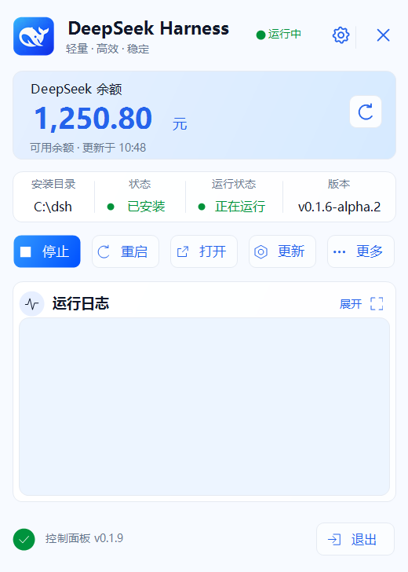

# DeepSeek Harness 控制面板

用于 Windows 10/11 x64 的 DeepSeek Harness 管理工具。启动后常驻通知区域（系统托盘），点击图标弹出控制面板：检测本机安装、安装官方 Harness、启动、重启、停止、检查更新，并显示 DeepSeek 账户余额。



## 包含内容

- `src/DeepSeekHarnessControlPanel.cs`：Windows Forms 源码
- `assets/DeepSeekHarness.ico`：蓝鲸程序图标
- `scripts/build.ps1`：本地构建脚本
- `scripts/test.ps1`：策略层测试脚本
- `scripts/build-installer.ps1`：生成 per-user 安装包
- `scripts/verify-installer.ps1`：校验安装脚本（不需要 Inno Setup）
- `installer/DeepSeekHarnessControlPanel.iss`：Inno Setup 安装脚本
- `tests/`：策略类测试（纯逻辑，不依赖网络与 Harness 安装）
- `tools/`：开发期校验工具（托盘行为、缩放审计、界面渲染），不随安装包发布
- `LICENSE`：MIT 许可证
- `docs/images/panel.png`：上面的界面截图，由测试渲染生成

本仓库不包含 API Key、用户配置、Harness 安装目录、依赖缓存或测试日志。

控制面板自身在本机只写这些位置：`%LOCALAPPDATA%\DeepSeekHarnessManager\settings.json`（安装目录、每日一次更新检查的日期）、`%LOCALAPPDATA%\DeepSeekHarnessManager\balance-key.dat`（DPAPI 加密的余额密钥），以及安装目录下的 `dsh-control-panel-error.log`（仅在出现未预期错误时写入）。

## 构建

在 Windows PowerShell 中运行：

```powershell
powershell -ExecutionPolicy Bypass -File .\scripts\build.ps1
```

生成的程序位于 `bin\DeepSeekHarnessControlPanel.exe`。

面板正在运行时 `bin\DeepSeekHarnessControlPanel.exe` 会被占用，此时重建会以 `CS1567` 失败。用 `-OutputDirectory` 把产物输出到别处即可在不关闭面板的情况下编译：

```powershell
powershell -ExecutionPolicy Bypass -File .\scripts\build.ps1 -OutputDirectory .\bin-staging
```

`scripts\test.ps1` 接受同样的参数：

```powershell
powershell -ExecutionPolicy Bypass -File .\scripts\test.ps1 -OutputDirectory .\bin-staging
```

### 界面截图

README 顶部的 `docs/images/panel.png` 是渲染出来的，不是手工截屏。测试里的 `TrayPopupRenderingTests` 会构造真实的托盘弹窗，用 `DrawToBitmap` 画出客户区并存成 `tray-preview.png`，所以界面改动后重新生成一次，截图就不会停留在旧版本：

```powershell
powershell -ExecutionPolicy Bypass -File .\scripts\test.ps1 -OutputDirectory .\bin-staging
Copy-Item .\bin-staging\tray-preview.png .\docs\images\panel.png -Force
```

`LogViewRenderingTests` 仍会另外生成 `log-preview.png`，覆盖完整窗口（非托盘）版本的日志排版。

截图是代码画出来的，因此它同时也是一道检查：布局被改坏时，先看这张图比对着代码猜要快。

## 使用

运行控制面板后，它会常驻通知区域：

1. 右键点击托盘图标，在图标左上方弹出面板；再次右键点击、按 `Esc`、点“×”或切到其他程序都会收起面板。左键点击不弹出面板。收起不是退出。
2. 在未安装 Harness 的电脑上点击“安装”并选择空目录。
3. 安装完成后使用“启动”“重启”“停止”控制服务。主按钮会随状态在“安装 / 启动 / 停止”之间切换。
4. “检查 Harness 更新”仅检查官方 `deepseek-ai/deepseek-harness` 仓库的更新，不更新此控制面板。
   安装和更新时，只要官方源码提供 `build:official`，面板就会用它构建设备端资源，
   使页面左上角保持官方品牌；源码未提供该脚本时自动回退到普通构建，日志会写明用了哪种。
5. 日志区默认显示最近若干行；点“展开”可以把面板加高，“导出 / 清空”在日志区右键菜单里。
6. 面板底部的“退出”才真正结束控制面板。Harness 是独立进程，**服务不受影响**，需要时再从面板启动或停止它。
7. 右上角设置和“更多”按钮提供同一个菜单：目录、扫描、更新、卸载、更多设置。更多设置用于配置余额查询密钥；卸载会列出每个删除目标及大小，其中**用户数据默认不勾选**。

界面按模块尺寸排列：520×728（96 DPI 设计像素），展开日志为520×838。余额卡片112px、状态栏64px、单排按钮88×44px且间隔12px、默认日志卡片280px。普通屏幕按系统DPI缩放；空间不足时适配工作区。728px是各模块、间距和上下边距的实际总和。

日志默认自动换行，官方提交编号在面板中显示前 7 位；导出日志保留完整编号。

### DeepSeek 余额

余额来自官方接口 `GET https://api.deepseek.com/user/balance`，与 Harness 共用同一个 API Key：点面板右上角的齿轮粘贴 Key 即可，随后点“刷新余额”查询。返回的每个币种分开显示（例如 `1,250.80 元 / 5.31 USD`），不会换算成“积分”。

- Key 用 Windows DPAPI 按当前用户加密后存放在 `%LOCALAPPDATA%\DeepSeekHarnessManager\balance-key.dat`，弹窗里不会回显、日志里不会打印；也可以改用 `DEEPSEEK_API_KEY` 环境变量。
- 查询只会访问 `api.deepseek.com`。请求失败、Key 无效、余额不足都会显示具体原因，只有真返回 0 才显示 `0.00`。
- 面板每次弹出时刷新一次，5 分钟内不重复请求。

## 安装包

需要先安装 [Inno Setup 6](https://jrsoftware.org/isdl.php)（免费），然后运行：

```powershell
powershell -ExecutionPolicy Bypass -File .\scripts\build-installer.ps1
```

版本号从源码里的 `PanelVersionPolicy.Version` 读取，因此可执行文件的版本资源和安装包不会不一致。产物位于 `bin\installer\`。

没有安装 Inno Setup 时，脚本会说明缺少什么并以退出码 2 结束，而不会抛出堆栈。

### 安装包的行为

- **免 UAC**：安装到 `%LOCALAPPDATA%\Programs\DeepSeekHarnessControlPanel`，全程不需要管理员权限。
- **升级**：使用固定 `AppId`，新版本替换旧版本而不是并排安装。
- **开机自启**：默认不勾选；勾选后写入 `HKCU` 的 `Run` 项，与面板内的同名开关是同一处。
- 安装包只包含控制面板本身，Harness 仍由面板自行安装。

### 卸载边界（重要）

安装包的卸载器**只删除控制面板自己**，不会碰以下任何内容：

- Harness 安装目录（例如 `C:\dsh`）及其 `.dsh-runtime`、`logs`
- `%USERPROFILE%\.dsh` —— 其中的 API Key、会话记录和附件删掉无法恢复
- Harness 安装目录内的 `.dsh-manager-state.json`

删除 Harness 请使用面板内的“卸载”。两者必须严格分开：卸载一个几百 KB 的面板不应该连带丢掉无法恢复的凭据和会话。

这条边界不只写在注释里，`scripts\verify-installer.ps1` 会实际检查它——任何指向上述路径的指令、或 `[UninstallDelete]` 里的递归删除，都会让校验失败：

```powershell
powershell -ExecutionPolicy Bypass -File .\scripts\verify-installer.ps1
```

## 说明

此工具通过官方 GitHub 仓库下载 DeepSeek Harness，并使用本机的 Node.js/pnpm；缺失时会在 Harness 安装目录准备私有运行环境。它不是 DeepSeek 官方发布的桌面客户端。

### 网络传输

面板默认使用 .NET Framework 的 `HttpClient`。在某些代理配置下（例如 TUN + fake-IP 把所有域名解析到 `198.18.0.0/15`），.NET 的 SCHANNEL 无法完成 TLS 握手，报“未能创建 SSL/TLS 安全通道”，而 Node 的 OpenSSL 栈可以正常连接。此时面板会自动改用内置的 Node 取回脚本继续请求，并在日志中说明切换原因。该回退是被动的：.NET 正常工作时不会启用，也不会在 `%TEMP%` 留下任何文件。

余额查询使用同一条回退路径：先走 .NET，失败时改由 Node 的 `https` 模块请求 `api.deepseek.com`，密钥只通过标准输入传给子进程，不出现在命令行参数、临时文件或日志里，证书校验保持开启。

本地 Harness 页面（`127.0.0.1:3080`）的探测始终走 .NET，不受影响。

## 许可证

[MIT](LICENSE)。可以自由使用、修改和再分发，只需保留版权声明与许可证原文。
